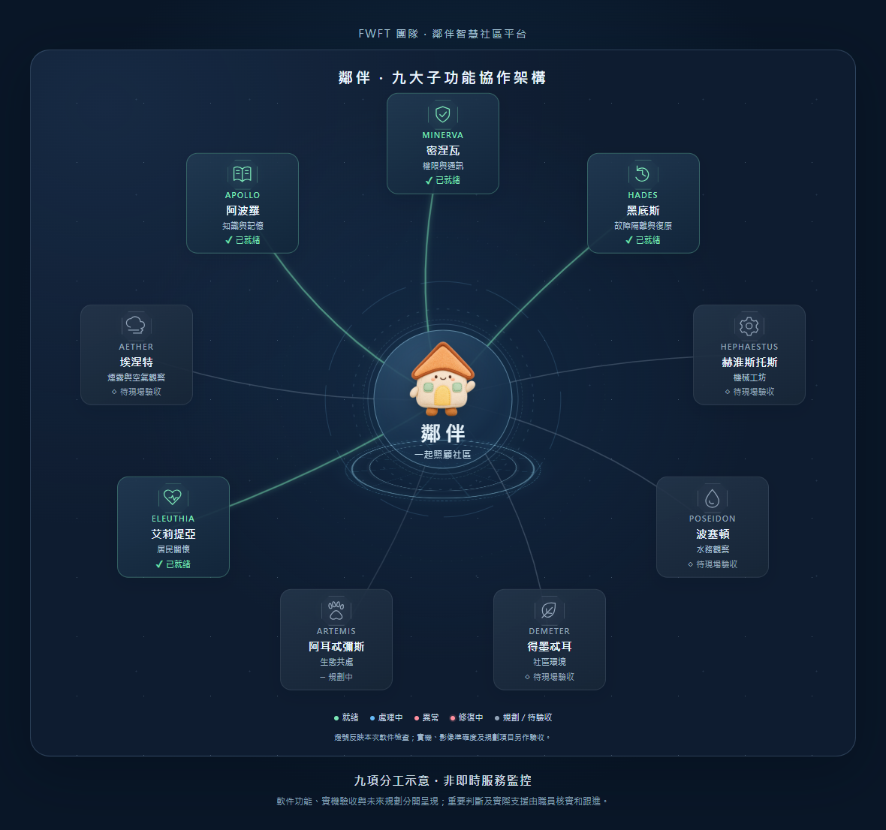

# 鄰伴智慧社區平台 · FWFT 團隊

**鄰伴是具備情境理解與情感回應能力的統籌與主控 AI 平台。**我們把社區看成一個需要共同照顧的小生態圈：數字人聆聽居民，機械人提供現場線索，各子功能整理知識、關懷需要及環境問題，再由管理人員核實和跟進，讓支援更早到達。

平台以九個工作分工協作：密涅瓦 MINERVA（權限與通訊）、黑底斯 HADES（故障隔離與復原）、赫淮斯托斯 HEPHAESTUS（機械工坊）、波塞頓 POSEIDON（水務觀察）、得墨忒耳 DEMETER（社區環境）、阿耳忒彌斯 ARTEMIS（生態共處）、艾莉提亞 ELEUTHIA（居民關懷）、埃涅特 AETHER（煙霧與空氣觀察）、阿波羅 APOLLO（知識與記憶）。

[完整介紹與各項實作狀態](docs/neighbour-fwft-introduction-2026-11-05.md) · [架構對照及參考來源](docs/gaia-community-architecture-2026-11-05.md)

居民對話、查詢與職員跟進已可使用；實機 S1、真實定位及自主行車仍待驗收，生態及空氣感測屬未來發展。九個名稱代表分工，不表示九個獨立大模型或自我意識。載入圖使用原創圖示及鄰伴吉祥物，燈號表示本次程式載入核對；不把綠燈當作雲端服務保證或實機安全認證。

啟動展示：中央旋轉圓盤展開九項分工，燈號對應本次載入證據；就緒後轉為清單及原創3D功能示意，再柔和淡出。可立即進入；上方「認識鄰伴」與「資料與私隱」並列，按入直接開啟協作圓盤。未來／待實機功能不會假亮綠燈。

---

## 最新已部署：圓盤及載入畫面一頁顯示

入口：[鄰伴智慧社區平台](https://neighbour-yuenhk-live.onrender.com/)。版本 `f1fc0ddb66aa11c60c252dec69f091d01e1aaf5d`／barrier30，Render Free Singapore 單實例。

協作圓盤、清單／3D、載入及冷啟動頁隨可用寬高調整；私隱文字及角色來源正常換行。兩瀏覽器 16 組尺寸及完整部署檢查通過，原有資料與歷史用量核對保留，Gemma＋Microsoft 語音服務不變。

[本次版面修正及驗證](docs/viewport-fit-2026-11-05.md)。文件提交不會再次部署。

## 先前部署：認識鄰伴協作圓盤入口

入口：[鄰伴智慧社區平台](https://neighbour-yuenhk-live.onrender.com/)。版本 `8cc09841fb776b7a09d6eed12761f0f7bca3ab46`／barrier29，保留 Render Free Singapore 單實例。

「認識鄰伴」已移至「資料與私隱」旁，採用同款樣式；按入直接顯示協作圓盤，移除外圍長篇介紹。九項分工、燈號、清單及 3D 展示保留；載入動畫不變。兩瀏覽器及完整部署檢查通過，原有資料及歷史用量核對保留。

[本次介面更新及驗證](docs/community-menu-2026-11-05.md)。這次文件提交不會另行部署。

## 先前部署：九子功能展示與原創圖庫

入口：[鄰伴智慧社區平台](https://neighbour-yuenhk-live.onrender.com/)。版本 `b6f2c990d26985e103b4e78180857a8e66306c30`／barrier28，Render Free Singapore 單實例，autoDeploy=no。

- 旋轉核心展開九項分工，真實燈號、有限安全重連、清單與原創 3D 示意、柔和淡出；可立即進入或從「認識鄰伴」開啟協作圓盤。未來／待驗收保持灰色。
- 載入畫面未揭開前不送 ASR，保留 Gemma＋Microsoft 曉曼 F0。
- 八款新模型，原233保留，共241個不同檔案；目前15個合資格獨立來源，20目標仍差5，沒有用鏡像湊數。
- 820後端／112Node／36離線題庫、兩瀏覽器及frontend94三檢通過；74正式HTTPS資源同，原十個個案、短號、設定、記憶與歷史用量核對保留。沒有實際AI／聲畫／EP操作。

[本次更新及驗收範圍](docs/community-launch-2026-11-05.md)。下方為歷史版本紀錄；文件提交不會重新部署健康服務。

---

# 2026-11-05 鄰伴：模型與多標記定位／離機行車

正式入口：https://neighbour-yuenhk-live.onrender.com/ 。runtime `5e0def858f45f3037d05da52d7810e01dac30691`，官方 CLI deploy `dep-dbluimtg1s2s73bhpkag`／barrier27，Render Free Singapore 單實例；autoDeploy=no。下面是歷史紀錄，毋須為文件重新部署。

- 新 Cat1 與 Godette 的授權、固定檔案、原生嘴眼／構圖、匯入、獨立居民讀回、署名及去重已隔離核對。原231款清單保留，共233款；未代人改正式模型。20個真正獨立、可共享匯入平台仍未達，不以研究連結、作者數或鏡像湊數。
- 加入 BoardLocaliser，明確以 --method board 分析已保存JPEG；至少兩標記、保留多解拒絕。54合成幀中，共同接受50幀的平均位置誤差由2.36cm降至0.875cm；並非真機精度／速度保證。
- 管理地圖下載套件含8個合成行車場景、遮擋感測及有限煞車積分；15cm/s故障測例300ms停定、1.95cm煞車位移只屬理想模擬。沒有硬件輸出；S1韌體／接線、真定位、避障及行車仍待現場驗收。
- 759後端／97Node、36離線題庫、網絡故障／兩瀏覽器及frontend92三檢通過；59HTTPS資產與inert冷啟資產同。10原個案／短號、設定模型、所有Opsflagsledger事件／MB842及歷史quota保留，沒有ENV／DDL／匯入或provider／聲畫／EP操作。
- GAIA蓋亞及九項子功能只屬[架構介紹提案](docs/gaia-community-architecture-2026-11-05.md)，未改品牌或新增九個大模型。

詳情：[本批進度](docs/gaia-expansion-2026-11-05.md)、[多標記定位](docs/board-localisation-2026-11-05.md)。Gemma＋Microsoft曉曼F0、免費及90日保存規則不變；舊服務保持暫停，本機維持cloud主資料來源。

這次後續README／docs提交只有文件，不另部署。

---

# 2026-11-05 鄰伴：免費模型、骨架動畫與 S1／定位準備

最新正式入口：https://neighbour-yuenhk-live.onrender.com/ 。runtime `dd54a31b66422006b26aa04fa971297460920784`，官方 CLI deploy `dep-dbltpe5g1s2s73bf6sr0`／barrier26，Render Free Singapore 單實例。下面各日期章節是歷史版本，不代表需要重新部署。

- 三個已核對固定來源提供四款新 VRM；原227款保留，共231不同檔。二十一個研究來源不等於二十個完整可匯入來源，20目標仍未達。新款可以預覽及沿原流程儲存，沒有代人更換正式模型。
- 加入獨立 MIT／Apache Rigby JSON／PNG 骨架動畫格式，接原生 AIRI 匯入、共享、嘴部骨架及命名動作。官方付費 Spine 不採用，不接受任意 .skel 或全部 Spine 功能；素材授權獨立。
- 機械人地圖內可下載 S1 官方 Lab／SBus、固定標記定位與閉環離機工具。沒有串口／SDK實體輸出，真接線、座標校準、即時避障及自主行車仍待現場驗收。
- 715後端／96Node、網絡故障／兩瀏覽器／36題庫及frontend91三檢通過，57真HTTPS資產同；10原個案、短號、設定、模型、MB842、所有Ops、flags、ledger、events及歷史quota保留。只有新簽署技術放行行，沒有ENV／DDL／資料重匯／AI及EP測試操作。

詳情：[本批進度](docs/free-paths-2026-11-05.md)、[免費動畫格式](docs/free-skeletal-animation-2026-11-05.md)、[模型來源](docs/reviewed-library-imports-2026-11-05.md)、[S1接入條件](docs/s1-free-integration-2026-11-05.md)。Gemma＋Microsoft曉曼F0不變；不付費、不清quota、不啟動EP。GitHub自動CI仍按本人要求取消。

本次後續 README／docs 提交只有文件，runtime仍為上面版本，autoDeploy=no；不要為文件重部署。

---

## 歷史紀錄

# 2026-11-05 鄰伴：圖庫、巡查規劃及智能屏幕

正式入口：https://neighbour-yuenhk-live.onrender.com/ 。本批runtime `537e3bb0ef94980f450880fbbc9d423899b5c818`，Render官方CLI／Free Singapore單實例，原有10個案、模型、設定、記憶標記及歷史用量保留。

新增BOOTH／itch公開目錄讀取，連同原3個metadata來源及VRoid連接。20來源只是研究／搜尋登記，不代表20個全部已接通或授權可匯入；原227可用模型保留。機械人分頁新增加密地圖及安全距離路線模擬，不會連線或移動EP；S1只列官方Lab能力，真正外部遙控及自主行車未完成。巡查驗證加入可見線索及有界時間／機體核對，實景準確率待驗收。服務用量新增網頁智能屏幕準備，不能代批准鏡頭或咪。

516後端／77Node／Chromium與WebKit／36組對話評估及frontend88建置通過，50個正式HTTPS資產核對相同。Spine因免費限制未新增正式共享。用戶已取消GitHub每次更新自動測試，push／PR觸發已移除；本機部署前隔離測試繼續保留。這個文件／workflow提交不更改runtime，不另部署健康服務。

---

# 鄰伴 / Neighbour — private cloud deployment

Current service: https://neighbour-yuenhk-live.onrender.com/ . Residents enter directly; management uses the configured shared password. The former neighbour-yuenhk.onrender.com service remains suspended and must not be resumed alongside this writer.

The reviewed program runs on Render Free in Singapore with one instance and automatic deployment disabled. It uses the existing Turso Free durable databases, Cloudflare Gemma dialogue, Azure HiuMaan F0 speech, Cloudflare Whisper speech recognition, and Tavily search. No paid upgrade, quota reset, or automatic provider substitution is enabled.

## 2026-11-04: local camera interaction and bounded startup recovery are live

Current runtime `735e1a124ba99d9fad25f455c4fa9f62e60f996e`, official CLI deploy `dep-dblbao0u01pc739nagm0`, release `avatar-interaction-20261104-barrier24`. Existing URL, selected model, accepted lip sync, Gemma, Microsoft HiuMaan F0, Whisper and Tavily remain unchanged. Free/Singapore/one instance, autoDeploy=no.

The entry wave now starts after the loading handoff, and quiet idle greetings occur at most every 45 seconds with no active conversation/draft/speech. Optional local-only face-position tracking moves the head and eyes without identity matching. Resident-only hand navigation, adapted from the user's QingmingPortal project, requires stable hover and pinch confirmation and cannot control robots or staff pages. Camera permissions require the user's browser grant, with no bypass. MediaPipe 1.2.2 is self-hosted with retained Apache-2.0 license and a narrow documented modification disabling its performance/usage telemetry; see `cloud_frontend/assets/face-1.2.2/NOTICE.json`.

Case photos require a delivered same-session case, clear purpose, preview and explicit confirmation. Cancelling uploads nothing. The server sanitizes a <=40KB JPEG, encrypts it under the existing durable Operations boundary, allows only authenticated staff viewing, and applies the original independent-ledger 90-day completion rule to live data and managed backups/restores. No identity matching or hidden/mandatory photo capture is enabled.

Initialization retries are bounded: same-origin program preloads retry once, a safe inactive frame reloads at most once, and available text service can open while another component needs attention. Active drafts/conversations are never reloaded and unknown chat/upload/case outcomes are not replayed. Provider outages, exhausted quotas and denied browser permissions are not claimed to be repairable by restarting the page.

449 backend tests, 68 Node tests, 36 dialogue evaluations, network fault tests and Chromium/WebKit workbench flows passed with an unchanged source fingerprint. Frontend87 lint/typecheck/build and native byte restoration passed. Real native avatar rendering, actual MediaPipe WASM with synthetic blank input, synthetic hand-button selection and confirmed/cancelled synthetic camera-photo paths were verified in isolation, without actual camera/microphone/audio/EP/provider calls or formal test cases. 48 exact HTTPS assets and auth rejection checks passed; all original 10 cases, numbers, models/settings, memory marker, controls, ledger, events, Operations including VRoid and historical quotas were preserved. Human camera/hand accuracy, real voluntary-photo flow, mobile notification delivery and EP acceptance remain pending; 227 models from 126 VRoid authors are not 20 independent platforms.

This README and bundle update is documentation only; do not redeploy it.

## Earlier 2026-11-04: expressive arm and upper-body gestures

The previous runtime `44b326619389b575777e1af002b14b3af5972c8e`, official CLI deploy `dep-dblaehrm8hqs738n2ecg`, release `avatar-body-20261104-barrier23`. Existing URL, selected model, accepted lip sync, Gemma and Microsoft HiuMaan F0 remain unchanged. No ENV, credentials, schema or resident-data migration.

The VRM driver adds a shoulder-height greeting wave, alternating open-hand speech gestures with quiet beats, a slight listening lean and gentler two-hand care gestures. Eleven upper-body bones blend over the native idle pose, return smoothly without drift and restore on reduced motion, hidden pages or model switches. The root, legs, camera, mouth and eyes are untouched. Other model rigs may expose fewer moving parts. These client-side gestures add no AI requests.

430 backend tests, 62 Node tests, network faults, Chromium/WebKit workbench flows and 36 dialogue evaluations passed for the unchanged runtime source. Frontend84 lint/typecheck/build and native byte restoration passed. The actual published Miku VRM was rendered in isolated native-browser tests for all four gestures, framing, settling and reduced motion. 39 production HTTPS program/assets and auth rejection checks passed. All original cases, short numbers, model/settings, memory marker, controls, ledger, events, Operations including VRoid and historical quota were retained. No real provider, microphone, playback, formal test case or EP operation was performed; new human body-gesture acceptance is pending.

This README and bundle update is documentation only; do not redeploy it.

## Earlier 2026-11-04: voice-driven lip sync and conversational movement

The previous runtime `fb7bd0c1ea4cef129d80fb711fd920f9ab5aeffb`, official CLI deploy `dep-dbl9egijnfac73f9r16g`, release `avatar-performance-20261104-barrier22`; existing URL and Gemma + Microsoft HiuMaan F0 remain unchanged. The selected character and every original case, model, memory marker, control flag, ledger, event, Operations record (including VRoid) and historical quota period were retained.

The resident PCM stream now feeds one stable analysis bus into AIRI's native VRM/Live2D lip driver. The installed wLipSync worklet and WASM are served from this origin without weakening CSP. Switching analysis cannot disconnect audible playback. Speech completion closes the mouth, and gentle head/chest gestures follow conversation while respecting reduced motion and the original idle pose. No webcam or resident face tracking is enabled.

430 backend tests, 60 Node tests, network faults, Chromium/WebKit workbench flows and 36 dialogue evaluations passed for the runtime source. Frontend80 lint/typecheck/build passed and native sources were restored byte-for-byte. Actual published Miku VRM mesh expressions and Live2D mouth inputs animated in silent synthetic-PCM loopback HTTPS tests and returned to zero. Thirty-nine exact production HTTPS program/assets and auth rejection checks passed; no actual provider, microphone, playback or EP calls were made. New human lip-sync/iPhone acceptance is not claimed. Old writer exit and the sole inert new instance were independently verified before a new signed release approval.

This README and bundle update is documentation only; do not redeploy it.

## Earlier 2026-11-04: responsive resident interface

The previous runtime was `9412ad86d14a2600fee150753f188d0152a14a5e`, official CLI deploy `dep-dbl84o6tlv9c73b9agt0`, release `resident-responsive-20261104-barrier21`. The public URL is unchanged. Conversation and speech provider/model/voice IDs, selected character and stored data are preserved; the visible voice name is now “Microsoft 語音服務”.

The resident view uses proportional desktop columns instead of squeezing the avatar beside a fixed 600px chat column. Bounded grid rows and a scrollable notice area keep the composer accessible when the viewport is short or follow-up/speech errors are long. Mobile retains the translucent chat panel. Public model attribution moves into the concise top privacy menu, with active-frame/origin checks, safe public URLs and an acknowledged standalone fallback outside the chat. Original author and Live2D notices remain accessible.

The final source-matching gate passed 426 backend tests, 56 Node tests, network faults, workbench Chromium/WebKit flows and 36 dialogue evaluations. Frontend75 lint, typecheck and build passed with native source restored. A full isolated resident portal passed 12 viewport sizes, resize/draft retention, long notices with a synthetic speech failure, safe attribution messaging and chat. Thirty-five real HTTPS pages/assets matched exactly; 201 unchanged thumbnail hashes match the prior release evidence. Original cases, IDs, selected model, presentation, memory marker, controls, deletion ledger, events and all Operations records including the sealed VRoid connection matched their stopped baseline; previous quota periods were nondecreasing. No resident data, credentials or models were reimported or republished, and no real AI/audio/EP requests were used to validate this UI change. The old formal process was confirmed exited before the sole new release was approved.

This README/bundle metadata update is documentation only and does not require another deployment.

## Earlier 2026-11-04: reviewed VRoid library

Runtime commit `bfd84823d65d0f4390711ecae75bcf4cdf9ca787` was deployed with the official Render CLI as `dep-dbl7apmc6qcc73ak9reg`, release `vroid-library-20261103-barrier20`. The prior process had actually exited; only the new inert instance was present before independent data checks and release approval. This documentation update does not require another deployment.

The picker retains 26 existing curated models and adds 201 distinct reviewed VRM files from 126 VRoid creators, for 227 choices. This does not represent 20 independent library platforms or 227 Live2D models. Models were checked as original files and in native AIRI previews; blank, deformed, unsuitable and near-duplicate variants were excluded. Downloads recheck author permissions, version, size and SHA-256. Preview does not publish; the existing explicit Save action publishes through the immutable content store. Current selections remain unchanged.

The owner approved the existing cloud credential destination. VRoid credentials were transferred once over the fixed authenticated HTTPS endpoint and independently read back from durable AES-GCM storage outside Git. The program permits catalogue/resource reads and OAuth renewal, and blocks media publication, likes and account mutations. The cloud now owns token renewal; the encrypted local prior copy is preserved and cannot compete for renewal. Bounded latest-model discovery caches candidates separately from verified usable choices.

Verification included the source-matching isolated gate (426 backend tests, 54 Node tests, network faults, Chromium/WebKit flows and 36 dialogue evaluations), six operator tests, 232 exact public HTTPS assets and unauthorized API rejection. A real 19,381,084-byte cloud preview matched the previously verified public original without publishing a model. Original cases, short IDs, presentation, stored models, memory marker, controls, deletion ledger, events and pre-existing Operations records matched their stopped baseline; all previous quota periods were nondecreasing. Only the new sealed VRoid namespace was intentionally added. No Gemma, speech, real microphone, playback or EP calls were made for this release.

The owner previously accepted iPhone text, microphone and speech, session handover and physical Notebook-off digital-human use. Real mobile push delivery, EP hardware/site-vision acceptance and the goal of 20 independent compatible library sources remain outstanding. The Windows installer and Chrome troubleshooting were cancelled.

The 2026-10-31 repair fixes unsupported remote estate cache polling and self-hosts the exact ONNX runtime required for browser voice activity detection. Bounded recovery renews expired anonymous sessions and retries only requests proven not to have reached their operation/provider. Unknown outcomes retain the draft and are not blindly replayed. The workbench restores cloud-supported presentation settings, equally spaced navigation, and a compact truthful quota view.

For the original 2026-10-31 repair, the old process was confirmed stopped before the new service connected to the same stores. No resident data was reimported. The additive presentation table was independently read back; historical quotas and control flags were preserved. Fixed HTTP checks retained conversation context, returned HiuMaan audio, and recognised a synthetic Whisper sample. Those agent checks did not use a real microphone, play audio or operate EP; subsequent human acceptance is recorded above.

Native startup remains fenced; the launcher opens the new cloud URL. EP hardware requires a separate site connection and is outside this cloud repair. Keep the original local hardware files and audit intact. Future runtime deploys or restores still require stopping the sole formal writer; the in-process gate is not a distributed lease. Documentation-only commits do not require deployment.

This private repository contains program and synthetic test assets only. Resident databases, photos, memories, credentials, native models, and execution files are excluded. Private operational evidence lives outside Git. See deploy/cloud/README.zh-Hant.md and deploy/cloud/REPAIR-2026-10-31.zh-Hant.md for implementation and limitations.

## wLipSync 1.3.0 license

The native audio-analysis dependency is retained under its original MIT license:

The MIT License (MIT)

Copyright (c) 2021 hecomi
Copyright (c) 2024 Noeri Huisman

Permission is hereby granted, free of charge, to any person obtaining a copy of this software and associated documentation files (the "Software"), to deal in the Software without restriction, including without limitation the rights to use, copy, modify, merge, publish, distribute, sublicense, and/or sell copies of the Software, and to permit persons to whom the Software is furnished to do so, subject to the following conditions:

The above copyright notice and this permission notice shall be included in all copies or substantial portions of the Software.

THE SOFTWARE IS PROVIDED "AS IS", WITHOUT WARRANTY OF ANY KIND, EXPRESS OR IMPLIED, INCLUDING BUT NOT LIMITED TO THE WARRANTIES OF MERCHANTABILITY, FITNESS FOR A PARTICULAR PURPOSE AND NONINFRINGEMENT. IN NO EVENT SHALL THE AUTHORS OR COPYRIGHT HOLDERS BE LIABLE FOR ANY CLAIM, DAMAGES OR OTHER LIABILITY, WHETHER IN AN ACTION OF CONTRACT, TORT OR OTHERWISE, ARISING FROM, OUT OF OR IN CONNECTION WITH THE SOFTWARE OR THE USE OR OTHER DEALINGS IN THE SOFTWARE.
