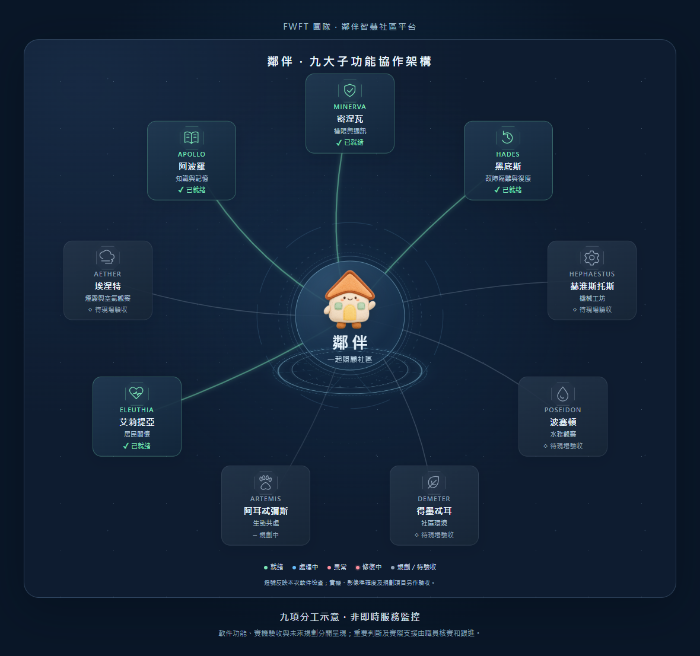

# 鄰伴智慧社區平台

**聆聽居民需要，協助職員跟進，讓社區支援更早到達。**

鄰伴由 **FWFT 團隊**設計，是具備情境理解與情感回應能力的統籌與主控 AI 平台。我們把社區看成一個需要共同照顧的小生態圈：數字人聆聽居民，機械人提供現場線索，再由管理人員核實及跟進。

**[開啟鄰伴平台](https://yuenhk.github.io/neighbour/)** · [完整介紹](docs/neighbour-fwft-introduction-2026-11-05.md) · [文件導覽](docs/README.md)

## 可以幫到邊啲人？

| 使用者 | 可以做甚麼 |
| --- | --- |
| 居民 | 用廣東話或文字傾談、查屋苑資料、提出求助，並用簡短個案編號查進度。 |
| 管理人員及保安 | 在管理工作台查看求助、關懷及現場回報，接手個案、補充資料及回覆居民。 |
| 現場巡查人員 | 使用機械人管理、遙控入口、巡查回報及地圖規劃工具；實機能力按現場驗收進度開放。 |

## 一個求助，怎樣得到跟進？

**居民提出需要 → 鄰伴了解及補充資料 → 職員核實、接手及回覆 → 居民查詢進度**

例如，居民說廚房水喉漏水，之後再補充「一樓一室、已漏了兩日」，系統會判斷是否更新同一個案。一般知識查詢，例如垃圾分類，則先提供資訊。

情緒及壓力需要會進入關懷分流，提供初步支援並交由職員跟進；這並非醫療診斷。

## 怎樣開始使用？

1. 開啟平台，直接進入「居民服務台」；語音需由裝置使用者允許咪高峰權限。
2. 職員進入「管理工作台」，使用既定管理口令登入。
3. 查看「求助查詢」、「關懷」或「現場回報」，選擇個案接手及更新進度。

居民對話及管理資料由雲端提供，Notebook 關機後仍可使用。**機械人鏡頭及控制仍需要現場電腦、網絡與實機**，相關能力須另作現場驗收。

## 九項分工，一起照顧社區

平台參考《地平線》蓋亞的協作構思。九個名稱代表功能分工，並非九個獨立大模型；各項目前進度見下節及完整介紹。

查看九項分工

| 子功能 | 負責甚麼 |
| --- | --- |
| 密涅瓦 MINERVA | 權限、通訊及操作保護 |
| 黑底斯 HADES | 故障隔離、有限重試及備份復原 |
| 赫淮斯托斯 HEPHAESTUS | 機械人、巡查工具及角色模型 |
| 波塞頓 POSEIDON | 漏水、積水線索及跟進 |
| 得墨忒耳 DEMETER | 垃圾、清潔及社區環境 |
| 阿耳忒彌斯 ARTEMIS | 未來的動物與社區生態支援 |
| 艾莉提亞 ELEUTHIA | 居民對話、需要了解及關懷跟進 |
| 埃涅特 AETHER | 煙霧、火警候選及未來的空氣觀察 |
| 阿波羅 APOLLO | 屋苑知識、搜尋及記憶 |

## 目前做到哪裏？

截至 **2026 年 11 月 5 日**：

- **已有並經用戶實測**：廣東話文字／語音對話、Microsoft 朗讀、對話上下文、同一個案補充、職員跟進及進度查詢、閒置交接，以及 Notebook 關機後的手機使用。
- **已有軟件、仍需現場驗收**：機械人相關控制與保護、巡查影像判斷、手機工作提示的實際接收；S1 接入、真實定位、避障及自主行車尚未完成實機驗收。
- **繼續補齊**：圖庫現有 241 個已核對的不同模型檔案，來自 15 個合資格獨立來源；20 個來源的目標仍差 5 個。
- **未來發展**：專門動物服務及空氣感測器整合。

展示動畫、模擬結果及燈號不等同實機驗收。詳細範圍見[功能介紹及狀態](docs/neighbour-fwft-introduction-2026-11-05.md)。

## 資料與私隱

- 鏡頭位置互動在裝置內處理；個案相片經居民預覽及確認後才上傳供職員跟進。
- 閒置後清除本輪對話及稱呼；明確要求保存的記憶與已提交個案按原有規則保留。
- 完成個案及附相保存九十日，平台管理的備份按同一規則處理；可向職員要求查閱、更正或刪除。
- 使用免費方案；額度耗盡時暫停相關服務，不自動購買或充值。

## 使用哪些服務？

數字人以 **AIRI** 為基礎；對話使用 **Cloudflare Gemma**，朗讀使用 **Microsoft 語音服務**，雲端收音使用 **Cloudflare Whisper**，網上查詢使用 **Tavily**。網頁及資料由 **Render／Turso 免費方案**提供。

## 想了解更多？

- [完整平台介紹與九項分工](docs/neighbour-fwft-introduction-2026-11-05.md)
- [使用、功能及開發文件導覽](docs/README.md)
- [目前部署版本與驗證範圍](docs/current-deployment.md)
- [開發及部署歷史紀錄](HISTORY.md)
- [第三方套件與素材授權索引](ACKNOWLEDGEMENTS.md)
