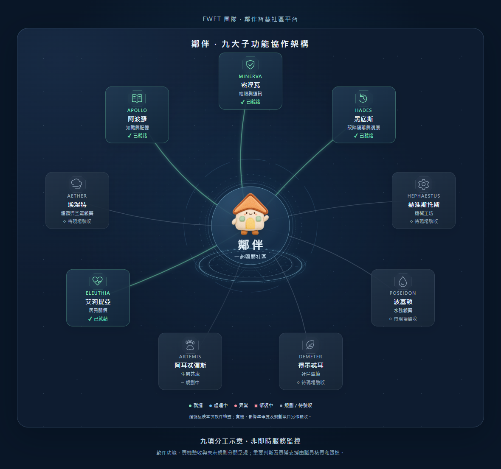

# 鄰伴九子功能展示與圖庫更新（2026-11-05）

本版已在原有免費雲端網址更新，保留 Gemma 對話、Microsoft 曉曼 F0、原有資料與所有控制保護。

## 從核心展開到功能清單

按用戶對參考影片 1:14 與 1:45 的描述設計原創動畫：中央圓盤緩慢旋轉，九個圖示由核心展開，介紹名稱、分工與本次載入狀態；必要畫面準備好後轉成可選清單及 3D 功能示意，再柔和發光淡出。可按「立即進入」跳過餘下展示；點左上平台名稱可重播及查看詳細分工。

綠色代表收到本次程式或設定的就緒證據，藍色代表處理中，紅色代表異常，紅色流動線代表有限次安全重連。規劃與待現場驗收保持灰色。動畫不會把未完成工作改成綠色，也不會為了檢查而試用 AI 額度或重送對話。3D 角色、機械人與感測器是原創程序示意，並非已連接實物；裝置選擇減少動態時直接顯示。

圖為架構示意，並非即時服務監控。

## 實際改善及核對

補上載入前的語音辨識守門，服務台正式顯示前不送出辨識請求。原生 Chromium 與 WebKit 都已用合成音訊核對：顯示前零請求，顯示後一次模擬辨識；沒有真人收音、播放或雲端 AI 呼叫。

新增八款已核對授權及原生匯入的模型，保留原有 233 款，共 241 個不同檔案。按本人同意的獨立原創庫定義，目前確認 15 個來源（其中 12 個 GitHub 原創庫），距離 20 個目標仍差 5 個，沒有用鏡像或作者數目湊數。各款預覽、明確儲存、另一個裝置讀回、署名及選單去重已隔離驗證；原有共享儲存上限不變。

完整五項部署守門、820 項後端測試、112 項 Node 測試、36 組離線對話題庫，以及嚴格同源安全設定下的兩瀏覽器流程通過。frontend94 語法、型別及建置檢查通過，暫用的原生檔案已還原。正式網址 74 項資源與已檢查版本相同，冷啟動 10 項資源亦已核對。

本次只更新程式與公開素材：十個原有個案及短編號、當前模型和角色設定、記憶標記、用量與保護狀態、刪除收據及事件紀錄核對保留；歷史用量沒有減少。保留原有九十日資料規則，只新增一筆簽署技術放行紀錄。沒有操作 EP、改計費、建立新憑證或清除 quota。

S1 韌體與接線、實際停止、真實定位、避障及自主行車仍待現場驗收；本次 3D 示意不代表已完成這些實體功能。
